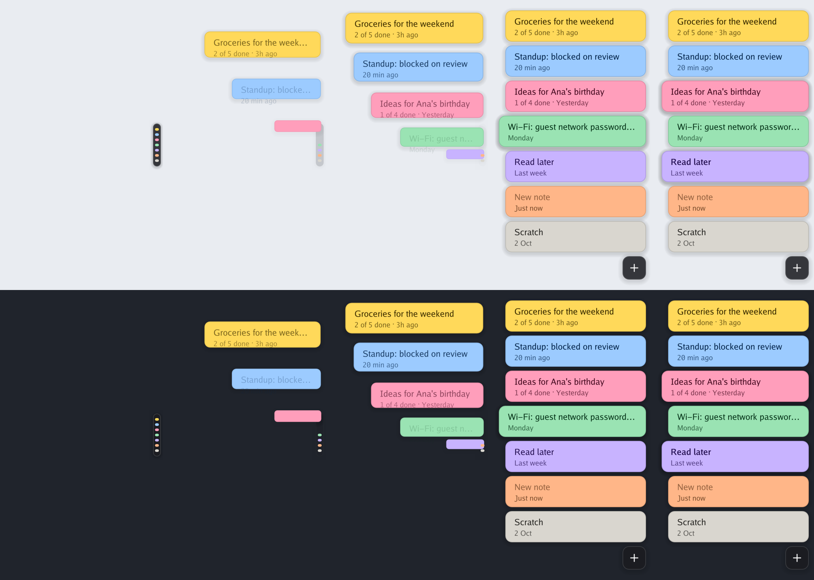
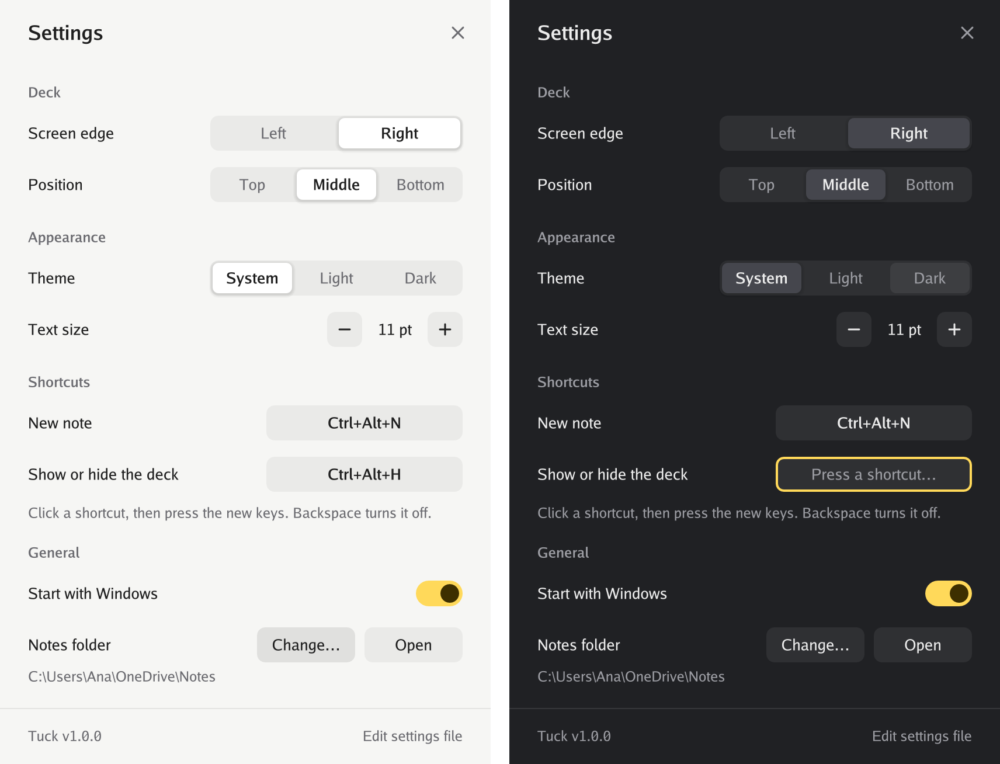

# Tuck

**Sticky notes that stay out of your way.** Tuck keeps every note in one slim
deck at the edge of your screen. Hover and it fans out; click a note and it
opens beside the deck; look away and it tucks itself back in.

A native Windows app in a single ~3 MB executable. No installer, no runtime,
no account, no telemetry — your notes are plain Markdown files in a folder.



> **Status: early.** Tuck has been tested on real Windows 10 hardware (4K,
> 125% scaling) as well as through its test suite and under Wine, but not yet
> used day-to-day. Expect rough edges, and please [report them](../../issues).

## Features

- **One deck, zero clutter** – a pill a few pixels wide shows one coloured
  dash per note. It sits against the very edge of the screen, so you can
  simply throw the pointer at it.
- **Hover to reveal** – dashes grow into labelled tabs, one after another.
  Move away and they fold back.
- **Click to write** – the note opens next to its tab, in a clean borderless
  window tinted in the note's colour. Saves as you type.
- **Never steals focus** – hovering and clicking the deck does not deactivate
  the app you are working in.
- **Pin as many as you like** – pin a note, or just drag it somewhere, and it
  stays on top while you work. Open another and it gets a window of its own;
  pinned notes come back where you left them when Tuck restarts.
- **Light Markdown** – headings, **bold**, _italic_, `code` and links are
  styled as you type, and `- [ ]` tasks tick off with a click. The file
  stays plain Markdown.
- **Seven colours**, light and dark themes (follows Windows by default).
- **Archive and undo** – archive notes you are done with; deleted notes go to
  a trash folder and the last one can be restored from the menu.
- **Steps aside** – the deck hides itself while a full-screen app, game or
  presentation is in front.
- **Plain files** – each note is a `.md` file. Sync the folder with OneDrive,
  Dropbox or Syncthing, edit it with any other tool, back it up however you
  like. Changes made elsewhere show up immediately, and if a note was edited
  in two places at once, both versions are kept.
- **Crisp on every display** – per-monitor DPI aware.

## Install

Download `tuck.exe` from the [releases page](../../releases) and run it. That
is the whole installation. To have it start with Windows, right-click the tray
icon and tick **Start with Windows**.

Requires 64-bit Windows 10 or 11 (x64 or ARM64).

### Build from source

```sh
git clone https://github.com/MatthewPocock/tuck
cd tuck
make build        # → bin/tuck.exe
```

This works from Windows, macOS and Linux alike; all you need is
[Go](https://go.dev/dl/). On Windows without `make`:

```powershell
go build -ldflags "-H=windowsgui" -o tuck.exe ./cmd/tuck
```

## Using Tuck

| Do this | To |
| --- | --- |
| Hover the pill at the screen edge | Fan out the deck |
| Click a tab | Open that note (click again to close it) |
| Click **+** | Start a new note |
| Right-click a tab | Change colour, archive or delete |
| Right-click the deck or the tray icon | Settings and everything else |
| Scroll over the deck | Scroll when there are more notes than fit |
| Drag the note's header | Move it — it stays pinned where you drop it |
| Click the pin | Keep the note on screen; other notes open beside it |
| Click a `[ ]` box | Tick a task off (or back on) |

### Keyboard

| Shortcut | Action |
| --- | --- |
| `Ctrl+Alt+N` | New note (works anywhere) |
| `Ctrl+Alt+H` | Hide or show the deck (works anywhere) |
| `Esc` or `Ctrl+W` | Close the note |
| `Ctrl+N` | New note |
| `Ctrl+PgDn` / `Ctrl+PgUp` | Next / previous note |
| `Ctrl+.` | Next colour |
| `Ctrl+P` | Pin / unpin |
| `Ctrl+B` / `Ctrl+I` | Wrap the selection in Markdown bold / italic |
| `Ctrl+Shift+Backspace` | Delete the note |

Shortcuts that act on a note act on the one you are typing in. Empty notes
are discarded when closed, so there is nothing to clean up after
an accidental `Ctrl+Alt+N`.

## Your notes

Notes live in `%AppData%\Tuck\notes` (tray icon → **Open notes folder**). Each
is a Markdown file with a few lines of front matter:

```markdown
---
color: yellow
created: 2026-10-14T09:30:00Z
updated: 2026-10-14T09:42:10Z
---

Groceries for the weekend

- [ ] oat milk
- [x] coffee beans
```

The first line becomes the note's label in the deck. Any `.md` file you drop
into the folder shows up as a note straight away — front matter is optional.
Deleted notes are moved to `notes\.trash`.

If a note changes on disk while you are typing in it (say, a sync client
delivers an edit from another computer), your version is saved and the other
one is kept next to it as a separate note named `… (conflict <date>)`.

## Settings

Right-click the tray icon or the deck and choose **Settings…** to change the
screen edge, position, theme, text size, shortcuts (click one and press the
new keys), start-up and the notes folder. Changes apply immediately.



Everything is stored in `%AppData%\Tuck\config.json` (**Settings… → Edit
settings file**; restart Tuck after editing by hand):

```json
{
  "edge": "right",
  "position": 0.5,
  "theme": "system",
  "editor_width": 360,
  "editor_height": 420,
  "font_size": 11,
  "notes_dir": "D:\\OneDrive\\Notes",
  "hotkeys": {
    "new_note": "Ctrl+Alt+N",
    "toggle_deck": "Ctrl+Alt+H"
  }
}
```

| Key | Values |
| --- | --- |
| `edge` | `"left"` or `"right"` |
| `position` | Where the deck sits along the edge: `0` (top) to `1` (bottom) |
| `theme` | `"system"`, `"light"` or `"dark"` |
| `editor_width`, `editor_height` | Size of the note window; also remembered when you resize it |
| `font_size` | Editor font size in points |
| `notes_dir` | Optional. Store notes somewhere else, e.g. a synced folder |
| `hotkeys` | Modifiers `Ctrl`, `Alt`, `Shift`, `Win` plus a key. `""` disables a shortcut |

If something misbehaves, `%AppData%\Tuck\tuck.log` is the place to look.

## How it is built

Tuck is written in Go and talks to Win32 directly — no cgo, no web view, no
UI toolkit. That is why it is one small file that starts instantly and sits
idle without using the CPU.

- The **deck** is a layered, always-on-top, non-activating window. Each frame
  is painted by portable Go code into an image with per-pixel alpha and handed
  to Windows as-is.
- The **editor** is a borderless window with a custom-drawn header and a
  native rich edit control for the text, so IME input, undo, selection and
  screen readers all behave the way Windows users expect.
- Everything that can be decided without Windows — layout, animation, hit
  testing, drawing, storage — lives in portable packages with unit tests. You
  can even render the UI to PNG on macOS or Linux with `make preview`.

See [CONTRIBUTING.md](CONTRIBUTING.md) for a tour of the code.

## Roadmap

Ideas that are not done yet — contributions welcome:

- A deck on every monitor (today: the primary monitor)
- Search across all notes
- Drag to reorder notes and to move the deck along the edge
- Colour emoji (the Windows 10 text control draws them in one colour)
- winget / Scoop packages

## Acknowledgements

The edge-deck interaction is inspired by
[Hold My Notes](https://holdmynotes.app) for macOS.

## License

[MIT](LICENSE)
