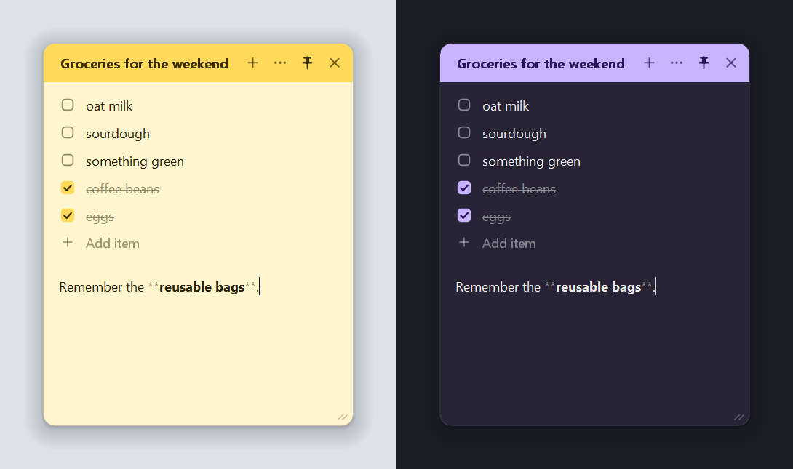
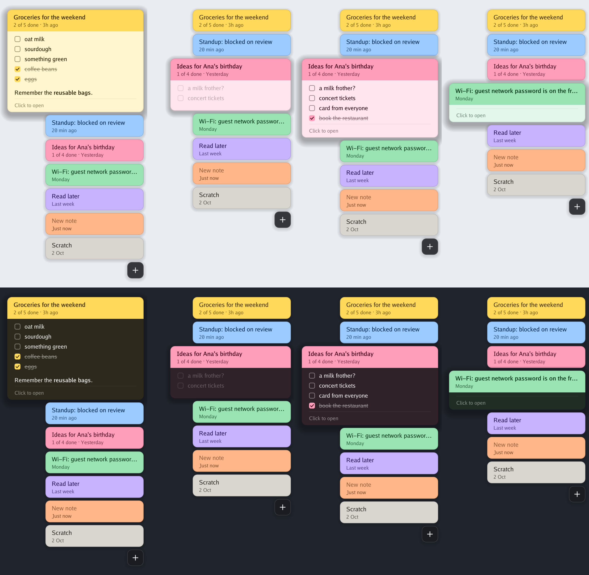
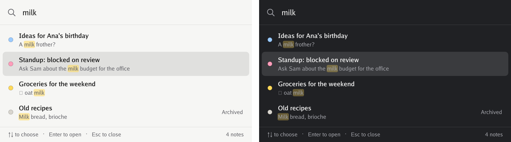

# Tuck

**Sticky notes that stay out of your way.** Tuck keeps every note in one slim
deck at the edge of your screen. Hover and it fans out; rest on a note to
read it right there in the deck; click it and it opens beside the deck; look
away and it tucks itself back in.

A native Windows app in a single ~3 MB executable. No installer, no runtime,
no account, no telemetry — your notes are plain Markdown files in a folder.


> **Status: first release.** Tuck is young. It is used and tested on Windows
> 10 at 4K and 125% scaling, and through its test suite, but expect some rough
> edges, and please [report them](../../issues).

## Features

- **One deck, zero clutter** – a pill a few pixels wide shows one coloured
  dash per note. It sits against the very edge of the screen, so you can
  simply throw the pointer at it.
- **Hover to reveal** – dashes grow into tabs, one after another, each with
  the note's title, how many of its tasks are done and when it last changed.
  Move away and they fold back.
- **Peek without opening** – rest the pointer on a tab and it grows into a
  card showing the rest of the note, ticked tasks and all, while the tabs
  below make room. The app you are working in keeps the focus.
- **Click to write** – the note slides out beside its tab, with a header in
  its colour, rounded corners and a soft shadow. It saves as you type and
  tucks itself away when you turn to something else.
- **Never steals focus** – the deck never takes the keyboard from the app you
  are working in; only opening a note to write in it does.
- **Pin as many as you like** – pin a note, or just drag it somewhere, and it
  stays on top while you work. Open another and it gets a window of its own;
  pinned notes come back where you left them when Tuck restarts.
- **Fold it away** – double-click a note's header to roll it up into a slim
  title bar, and again to roll it back down.
- **Search everything** – `Ctrl+Alt+F` finds any note by its words, archived
  ones included, and opens it with the match selected. With nothing typed it
  lists your most recent notes, so it doubles as a quick switcher.
- **Markdown that gets out of the way** – headings, **bold**, _italic_,
  `code` and links are styled as you type, and the Markdown symbols only show
  on the line you are editing. `- [ ]` tasks become checkboxes that tick off
  with a click, sinking below the ones still to do, and a note's first line
  moves up into its coloured header as its title. The file stays plain
  Markdown, and a note can be copied either as Markdown or as plain text.
- **Seven colours**, light and dark themes (follows Windows by default).
- **Archive and undo** – archive notes you are done with; deleted notes go to
  a trash folder and the last one can be restored from the menu.
- **Steps aside** – the deck hides itself while a full-screen app, game or
  presentation is in front.
- **Plain files** – each note is a `.md` file. Sync the folder with OneDrive,
  Dropbox or Syncthing, edit it with any other tool, back it up however you
  like. Changes made elsewhere show up immediately, and if a note was edited
  in two places at once, both versions are kept.
- **Crisp on every display** – per-monitor DPI aware.



## Install

Download `tuck.exe` from the [latest release](../../releases/latest) and run
it. That is the whole installation. To have it start with Windows,
right-click the tray icon and tick **Start with Windows**.

Requires 64-bit Windows 10 or 11. For Windows on ARM, download
`tuck-arm64.exe` instead.

Tuck is not code-signed, so the first time you run it Windows SmartScreen may
say it "protected your PC". Choose **More info → Run anyway**. Each release
lists the SHA-256 checksums of its files in `checksums.txt`.

### Build from source

```sh
git clone https://github.com/MatthewPocock/tuck
cd tuck
make build        # → bin/tuck.exe
```

This works from Windows, macOS and Linux alike; all you need is
[Go](https://go.dev/dl/). On Windows without `make`:

```powershell
go build -trimpath -ldflags "-H=windowsgui -s -w" -o tuck.exe ./cmd/tuck
```

## Using Tuck

| Do this | To |
| --- | --- |
| Hover the pill at the screen edge | Fan out the deck |
| Rest the pointer on a tab | Preview the note in the deck |
| Rest on another tab while a note is open | Put the open note away and preview the other |
| Click a tab | Open that note (click again to close it) |
| Click **+** | Start a new note |
| Right-click a tab, or click ⋯ in a note | Change colour, fold, copy, archive or delete |
| Right-click the deck or the tray icon | Settings and everything else |
| Scroll over the deck | Scroll when there are more notes than fit |
| Drag the note's header | Move it — it stays pinned where you drop it |
| Double-click the note's header | Fold it to its title bar, or unfold it |
| Click the pin | Keep the note on screen; other notes open beside it |
| Click a task's box | Tick it off (or back on) |
| Click **+ Add item** under a list | Start a new task |





### Keyboard

| Shortcut | Action |
| --- | --- |
| `Ctrl+Alt+N` | New note (works anywhere) |
| `Ctrl+Alt+H` | Hide or show the deck (works anywhere) |
| `Ctrl+Alt+F` | Search notes (works anywhere; `Ctrl+F` in a note) |
| `Esc` or `Ctrl+W` | Close the note |
| `Ctrl+N` | New note |
| `Ctrl+PgDn` / `Ctrl+PgUp` | Next / previous note |
| `Ctrl+.` | Next colour |
| `Ctrl+P` | Pin / unpin |
| `Ctrl+B` / `Ctrl+I` | Wrap the selection in Markdown bold / italic |
| `Ctrl+Shift+Backspace` | Delete the note |

Shortcuts that act on a note act on the one you are typing in. Empty notes
are discarded when closed, so there is nothing to clean up after
an accidental `Ctrl+Alt+N`.

## Your notes

Notes live in `%AppData%\Tuck\notes` (tray icon → **Open notes folder**). Each
is a Markdown file with a few lines of front matter:

```markdown
---
color: yellow
created: 2026-10-14T09:30:00Z
updated: 2026-10-14T09:42:10Z
---

Groceries for the weekend

- [ ] oat milk
- [x] coffee beans
```

The first line becomes the note's label in the deck. Any `.md` file you drop
into the folder shows up as a note straight away — front matter is optional.
Deleted notes are moved to `notes\.trash`.

If a note changes on disk while you are typing in it (say, a sync client
delivers an edit from another computer), your version is saved and the other
one is kept next to it as a separate note named `… (conflict <date>)`.

## Settings

Right-click the tray icon or the deck and choose **Settings…** to change the
screen edge, position, theme, text size, shortcuts (click one and press the
new keys), whether ticked tasks move to the end of their list, start-up and
the notes folder. Changes apply immediately.


Everything is stored in `%AppData%\Tuck\config.json` (**Settings… → Edit
settings file**; restart Tuck after editing by hand):

```json
{
  "edge": "right",
  "position": 0.5,
  "theme": "system",
  "editor_width": 360,
  "editor_height": 420,
  "font_size": 11,
  "notes_dir": "D:\\OneDrive\\Notes",
  "sink_done_tasks": true,
  "hotkeys": {
    "new_note": "Ctrl+Alt+N",
    "toggle_deck": "Ctrl+Alt+H",
    "search": "Ctrl+Alt+F"
  }
}
```

| Key | Values |
| --- | --- |
| `edge` | `"left"` or `"right"` |
| `position` | Where the deck sits along the edge: `0` (top) to `1` (bottom) |
| `theme` | `"system"`, `"light"` or `"dark"` |
| `editor_width`, `editor_height` | Size of the note window; also remembered when you resize it |
| `font_size` | Editor font size in points |
| `notes_dir` | Optional. Store notes somewhere else, e.g. a synced folder |
| `sink_done_tasks` | Move a task below the open ones when it is ticked off |
| `hotkeys` | Modifiers `Ctrl`, `Alt`, `Shift`, `Win` plus a key. `""` disables a shortcut |

If something misbehaves, `%AppData%\Tuck\tuck.log` is the place to look.

## How it is built

Tuck is written in Go and talks to Win32 directly — no cgo, no web view, no
UI toolkit. That is why it is one small file that starts instantly and sits
idle without using the CPU.

- The **deck** is a layered, always-on-top, non-activating window. Each frame
  is painted by portable Go code into an image with per-pixel alpha and handed
  to Windows as-is.
- The **editor** is a borderless window with a custom-drawn header and a
  native rich edit control for the text, so IME input, undo, selection and
  screen readers all behave the way Windows users expect. Task boxes and
  bullets are drawn over the text; on Windows 10, which neither rounds nor
  shadows such windows, a click-through layer behind the note draws its
  shadow and smooth corners.
- Motion follows [Material Design](https://m3.material.io/styles/motion):
  cards and tabs move on springs and windows use its emphasized easing.
- Everything that can be decided without Windows — layout, animation, hit
  testing, drawing, storage — lives in portable packages with unit tests. You
  can even render the UI to PNG on macOS or Linux with `make preview`.

See [CONTRIBUTING.md](CONTRIBUTING.md) for a tour of the code.

## Roadmap

Ideas that are not done yet — contributions welcome:

- A deck on every monitor (today: the primary monitor)
- Reminders on a note
- Pictures and screenshots in notes
- Drag to reorder notes and to move the deck along the edge
- Colour emoji (the Windows 10 text control draws them in one colour)
- winget / Scoop packages

## Acknowledgements

The edge-deck interaction is inspired by
[Hold My Notes](https://holdmynotes.app) and the previews by
[SideNotes](https://www.apptorium.com/sidenotes), both for macOS.

## License

[MIT](LICENSE)
